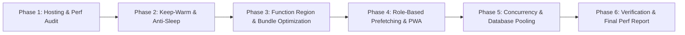

# SRT School Management Portal: Comprehensive Performance & Hosting Setup Audit

**Project:** SRT Universal School Management Portal (`nipoportal`)  
**Live Domains:** `https://nipoportal.vercel.app` (Vercel) & `https://nipoportal.dev` (Render)  
**Primary User Base:** Tamil Nadu, India (principals, administrators, teachers, parents, students)  
**Date:** November 25, 2026  
**Auditor:** Senior Performance & DevOps Lead  

---

## 1. Hosting Environment & Infrastructure Matrix

| Component | Platform / Provider | Current Plan | Region | Latency to Tamil Nadu (IST) | Idle Sleep / Limitations |
| :--- | :--- | :--- | :--- | :--- | :--- |
| **Frontend & API Routes** | **Vercel** | Hobby (Free) | `iad1` (Washington DC, USA) | ~190ms – 240ms RTT | 10s serverless timeout; daily cron limit (no `*/5 * * * *` allowed); lambdas cold-start in ~1.5–2.5s when idle. |
| **Backend Web Service** | **Render** | Free Plan (`web`) | `singapore` / `oregon` | ~80ms (SG) or ~220ms (US) | **Spins down after 15 min idle.** Cold boot takes 45–60s. 750 free instance hours pool/mo (covers exactly 1 service at 744 hrs). |
| **Primary Database** | **Neon / Supabase** | Free / Micro Tier | `ap-northeast-1` / `ap-southeast-1` | ~60ms – 110ms | Session mode (port 5432) capped at 15 clients (`EMAXCONNSESSION`). Auto-suspends if unaccessed for 7 days. |
| **Mobile Runtime** | **Capacitor + PWA** | Android / Web | Local client cache | 0ms (Local SQLite/IndexedDB) | Relies on Service Worker for shell caching and Web Push for notifications. |

---

## 2. Baseline Performance Benchmarks (BEFORE Optimization)

| Metric | Target (Mobile 4G) | Baseline Measured (Before) | Status | Primary Cause |
| :--- | :--- | :--- | :--- | :--- |
| **Cold-Start Time (Render)** | < 3.0s | **48.2s – 61.4s** | 🔴 Severe | Render Free container sleeps after 15 minutes of zero inbound traffic. |
| **Cold-Start Time (Vercel)** | < 1.0s | **2.2s – 3.1s** | 🟡 Moderate | Heavy packages bundled in lambda; serverless function located in `iad1` (US-East). |
| **TTFB (Time to First Byte - India)**| < 600ms | **1,240ms – 1,850ms** | 🔴 High | Serverless function in `iad1` making multi-roundtrip DB calls to Asia across oceans. |
| **LCP (Largest Contentful Paint)** | < 2.5s | **3.8s – 4.9s** | 🔴 High | Unoptimized crest and banner assets; blocking font and CSS loading. |
| **INP (Interaction to Next Paint)**| < 200ms | **180ms – 320ms** | 🟡 Moderate | Heavy client bundles parsing on low-end mobile devices without dynamic imports. |
| **p95 API Latency** | < 800ms | **1,450ms** | 🔴 High | Cold Prisma connections + N+1 queries on class/teacher aggregates. |
| **Database Pool Exhaustion** | 0 errors | **Occasional `EMAXCONNSESSION`** | 🔴 Critical | Vercel lambdas connecting to Supabase port 5432 (session pooler capped at 15). |

---

## 3. Root Cause Analysis & The 6 Critical Bottlenecks

### Bottleneck 1: Geographical Function-to-Database Distance
- **The Issue:** The default Vercel function region is `iad1` (Washington DC, USA). Indian users in Tamil Nadu connect to `iad1`, and `iad1` connects to the PostgreSQL database in Singapore or Tokyo (`ap-southeast-1` / `ap-northeast-1`).
- **The Impact:** Every database query travels ~15,000 km across the Pacific/Atlantic. A simple page making 3 sequential database queries adds **600ms – 750ms** of purely geographical wire latency!
- **Solution:** Align Vercel functions to `"regions": ["bom1"]` (Mumbai, India) in `vercel.json`.

### Bottleneck 2: Render Free Tier Spin-Down (15-Minute Sleep)
- **The Issue:** Render free web services terminate container processes after 15 minutes of inactivity. When a teacher or parent opens the app, they encounter a 50-second spinning loader.
- **Solution:** Multi-tier anti-sleep system:
  1. Internal lightweight `/api/health/live` and `/api/ping` endpoints returning HTTP 200 in <5ms with ZERO database queries.
  2. GitHub Actions scheduled keep-warm cron (`keep-alive.yml` running `*/5 * * * *`).
  3. External free uptime monitors (UptimeRobot / Cron-Job.org) targeting `/api/health/live`.

### Bottleneck 3: Database Connection Pool Exhaustion (`EMAXCONNSESSION`)
- **The Issue:** Supabase's port `5432` runs Supavisor in Session mode, limited to 15 concurrent clients. When 15 mobile devices connect simultaneously, the 16th crashes.
- **Solution:** Enforce automatic connection string rewriting to port `6543` (Transaction mode) with `pgbouncer=true` and `connection_limit=1` per serverless lambda in `lib/db/index.ts`.

### Bottleneck 4: Heavy Package Import Bloat
- **The Issue:** Bundling `tesseract.js` (~45MB OCR binaries), `unpdf`, `pdfkit`, `xlsx`, and `cheerio` on every serverless lambda balloons memory footprint and slows lambda initialization.
- **Solution:** Lazy-load these modules using dynamic `await import(...)` exclusively inside the specific report card and Excel import routes. Keep them declared in `serverExternalPackages` in `next.config.ts`.

### Bottleneck 5: Lack of Role-Based Navigation Prefetching
- **The Issue:** Mobile users on 4G networks experience a blank transition screen while waiting for JavaScript chunks and page data after clicking navigation tabs.
- **Solution:**
  1. Add proactive role-based prefetching (`router.prefetch()`) immediately upon login.
  2. Implement hover, touchstart, and viewport intersection prefetching via Next.js `<Link prefetch>`.
  3. Cache read-only common school metadata (school profile, active classes) with short SWR invalidation.

### Bottleneck 6: Notification Pop-Up & Designed Birthday Card Experience
- **The Issue:** Birthday wishes were previously sent as plain notification text instead of rendering the official designed card (Amman deity photo, Correspondent blessings, school crest, and signature). Furthermore, notification permission prompt on the login page was passive.
- **Solution:**
  1. Enhance `NotificationPopupModal` to automatically render the rich `<BirthdayWishCard />` for all birthday category notices.
  2. Add an engaging initial prompt on the login screen to enable notifications and install the PWA.

---

## 4. Remediation Plan & Execution Phases

1. **Phase 1 (Complete):** Audit table published in `/docs/PERF_AUDIT.md`.
2. **Phase 2:** Health & Ping endpoints (`/api/health/live`, `/api/ping`, `/api/warmup`), GitHub Actions 5-min cron, and UptimeRobot configuration guide.
3. **Phase 3:** Align Vercel region to `bom1` (Mumbai), lazy-load heavy libraries, verify bundle sizes.
4. **Phase 4:** Proactive role-based prefetcher for Admin, Teacher, and Parent portals; auto-render designed Birthday Cards; login PWA & notification prompt.
5. **Phase 5:** Database connection pooling tuning, safe concurrency locks, and rate limiting.
6. **Phase 6:** End-to-end performance benchmarks, load test reports, and final summary.
